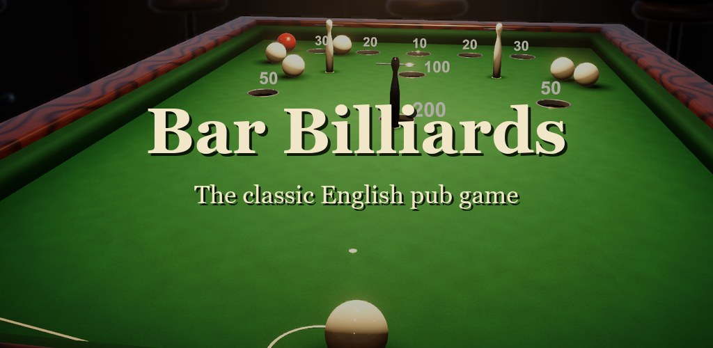
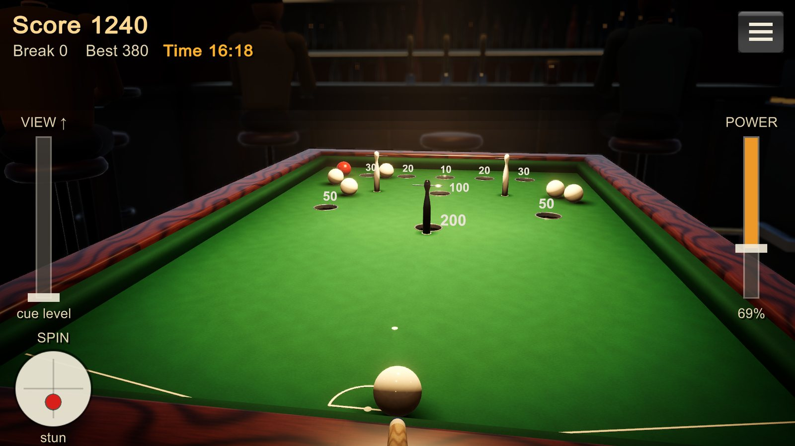
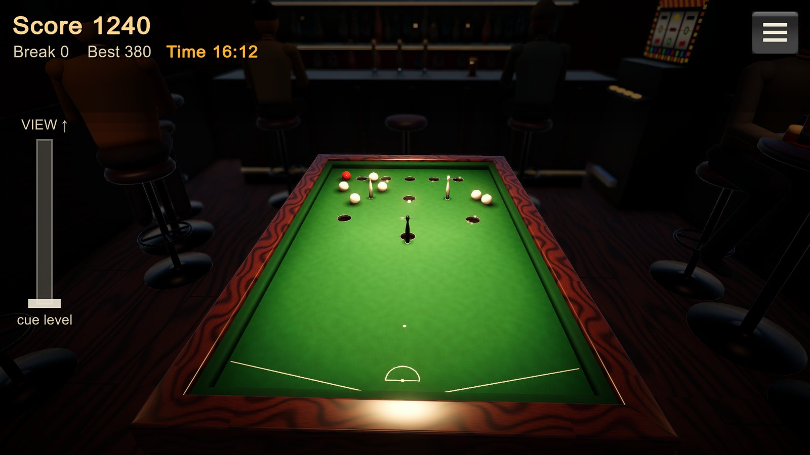
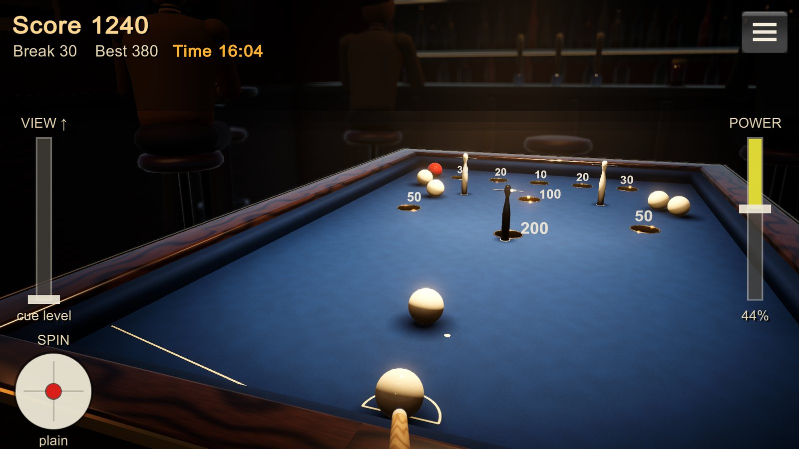

# Bar Billiards

Bar billiards is a classic English pub game, played on a small table that looks like a cross between a **pool table** and a **snooker table**, but with no pockets around the edge. Instead there are **nine holes in the cloth**, each worth points, and three wooden **pegs** standing guard. It's related to the old French game of **bagatelle**, and has been played in pubs across southern England since the 1930s.

You play against the clock: on a pub table a coin buys about 17 minutes, then a bar drops inside the table and the balls you pot stop coming back. Score as many points as you can before then.

This game recreates a full-size pub table in 3D, with real ball physics, the official English rules, and a pub to play it in.

## Highlights

  
<strong>A real pub table in 3D</strong>Realistic ball physics, cushions and spin. Pegs topple when you clip them, and balls rattle in the jaws of a hole.

  
<strong>The proper rules</strong>Holes worth 10 to 200, a red ball that scores double, the 17-minute pub clock, the bar drop and the last ball off a side cushion.

  
<strong>Play your way</strong>On your own, against a friend on the same device, or against five computer opponents from Novice to Champion.

  
<strong>Learn as you go</strong>An interactive tutorial with practice shots, and an aim guide you can set to Off, Standard or Full.

  
<strong>Make it yours</strong>Five cloth colours, four table styles, four peg styles, and real recorded sounds with optional pub ambience.

  
<strong>Free, no accounts</strong>Plays offline. Your scores and stats stay on your device, and a one-off purchase removes the ads for good.

## A look at the game

  <figure><figcaption><strong>The player's view.</strong> Cue drawn back, ready to strike.</figcaption></figure>
  <figure><figcaption><strong>Watching a shot run</strong> towards the holes and pegs.</figcaption></figure>
  <figure><figcaption><strong>Your table, your way.</strong> Tournament blue cloth on walnut and brass.</figcaption></figure>

[See all the screenshots →](screenshots.md)

## Where to play

Coming soon to **Android** phones and tablets on Google Play. **iPhone and iPad** are to follow.

The game is free. Your first three games have no ads. After that, a short ad may appear between games (never during one), at most every five minutes. **Remove ads** is a one-off purchase that switches them off for good. See the [privacy policy](PRIVACY.md) for what Google's ads collect; the game itself collects nothing.

## Find out more

- [How to play](how-to-play.md): the controls and the rules
- [Game options](game-options.md): modes, game length, customisation, the aim guide and high scores
- [Screenshots](screenshots.md)
- [Privacy policy](PRIVACY.md)

Also known as pub billiards, bagatelle, skittles billiards and mushrooms. If you like pool, snooker or billiards, give the pub's best-kept secret a try.
