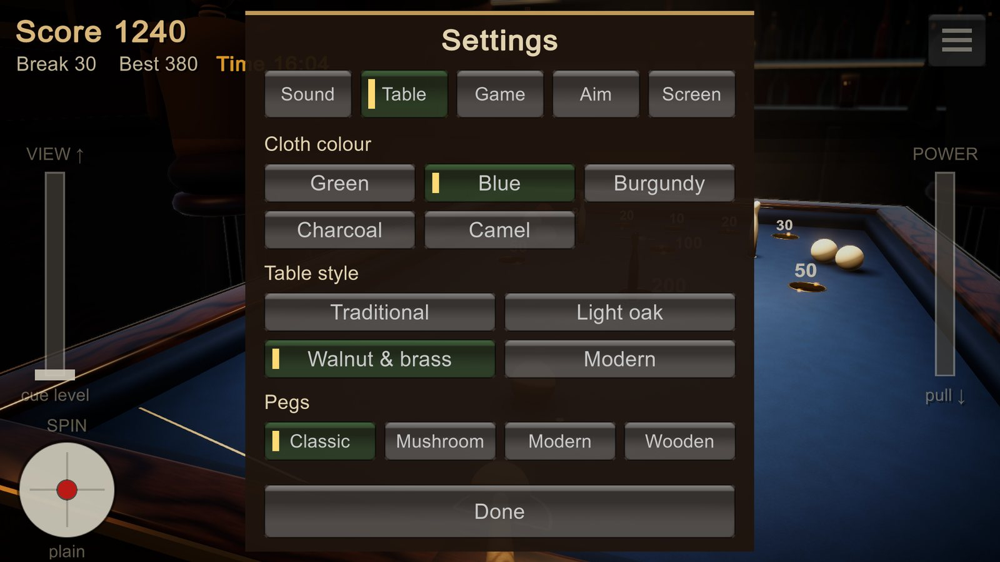
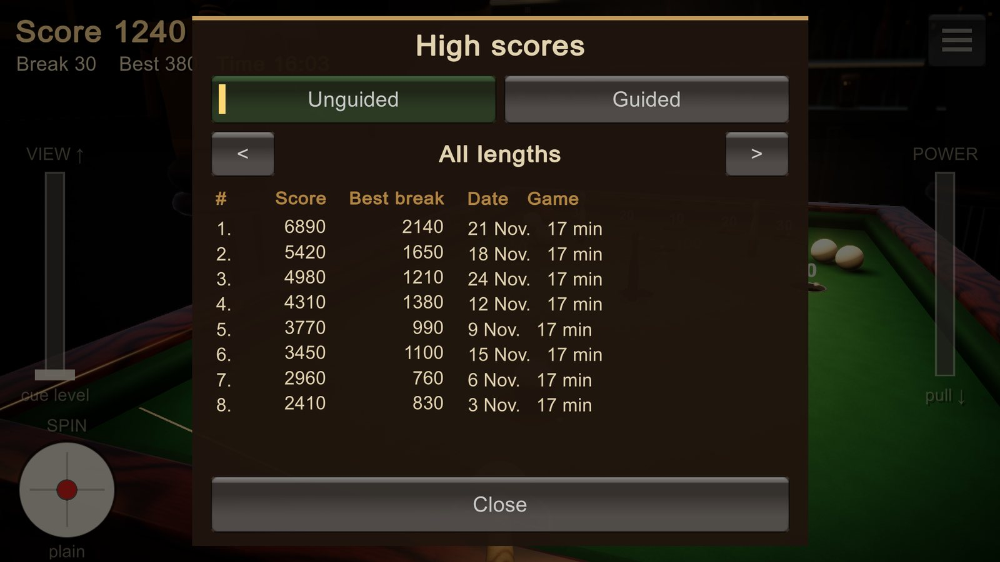
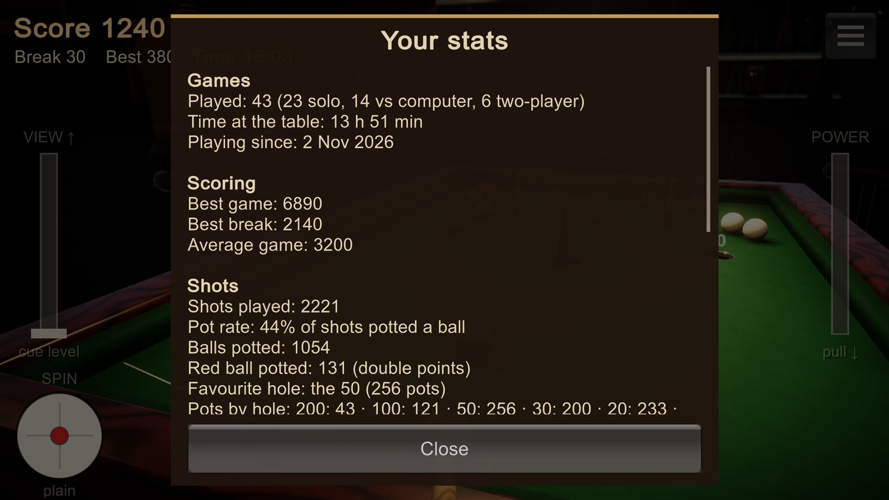

# Game options

## Single player

Play on your own against the clock or to a target score.

## Two players

Choose how to share the game:

- **Share the clock**, the pub way: your turn lasts as long as your break.
- **A number of turns each:** 3, 5 or 10.
- **Play to a score:** first to the target wins.

Play against:

- **Another person**, passing the device between turns. The clock waits until the next player taps.
- **The computer**, at five levels:
  1. Novice
  2. Pub regular
  3. League player
  4. County player
  5. Champion

The computer takes its turns like a person: it thinks, lines up and plays. The stronger levels use spin and choose where to place the ball in the D.

## Game length

- **Timed:** 5, 10, 15, **17 (the pub standard, and the default)** or 20 minutes, or no limit.
- **Play to a score:** 300, 500, 1000, 2000 or 5000 points.
- **When the bar drops:** end the game straight away, or keep with tradition and play on until the last ball goes down.

## Customisation

| Setting | Choices |
|---|---|
| Cloth | Classic green, Tournament blue, Burgundy, Charcoal, Camel |
| Table style | Traditional, Light oak, Walnut and brass, Modern |
| Pegs | Classic, Mushroom, Modern, Wooden |
| Ball sound | A real recording, or Soft pub, Crisp, Club room, Heavy or Original |
| Sound | On or off |
| Pub ambience | Off, Low or Medium: chatter and glasses, separate from the game sounds |
| Vibration | A buzz when you pot a ball, on or off |
| Brightness | Five levels, from Darkest to Lightest |
| Hole values | Show or hide the points beside each hole |
| Spin | On, or off for a simpler game |

## Aim guide

Choose how much help you get in **Settings → Aim**:

- **Full:** while you pull the power bar, shows where both balls will go at that power, including spin. Games played with it are marked "guided" and kept on their own high-score boards.
- **Standard:** shows the line to the ball you'll hit and the direction it will set off, but not exactly where the balls will end up.
- **Off:** no help at all, as in the pub.

## Interactive tutorial

On first launch the game offers a short tutorial, or lets you go straight in; it's never forced. The tutorial walks you through aiming, power, potting a ball, using the view, the pegs, spin and scoring, with practice shots at each step. Start it again any time from **Help → Tutorial**, and skip it at any point.

## High scores and stats

  <figure><figcaption><strong>High scores</strong></figcaption></figure>
  <figure><figcaption><strong>Your stats</strong></figcaption></figure>

**High scores** keep the top 10 games on each board, so like is compared with like:

- one board for each game length, ranked by score;
- one board for each target score, ranked by fastest time;
- separate boards for two-player games and for games against the computer;
- guided games (Full aim guide) kept apart from unguided ones.

**Your stats** (in the menu) shows your record on this device:

- games played and time at the table;
- best game, best break and average game;
- shots played, pot rate, balls potted, and your favourite hole;
- fouls, and white and black pegs knocked down;
- your record against each computer level.

## A pub to play in

The table stands in a pub with a bar, tall tables and stools, a dartboard, a fruit machine and a few regulars.
