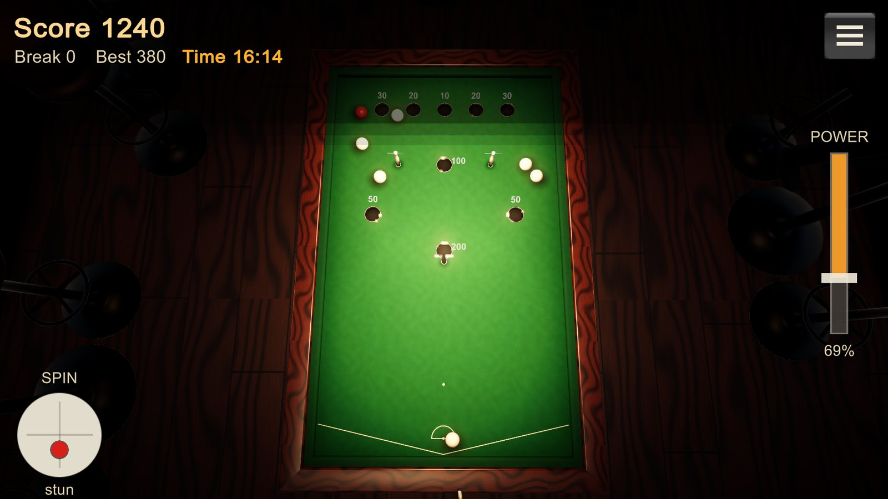
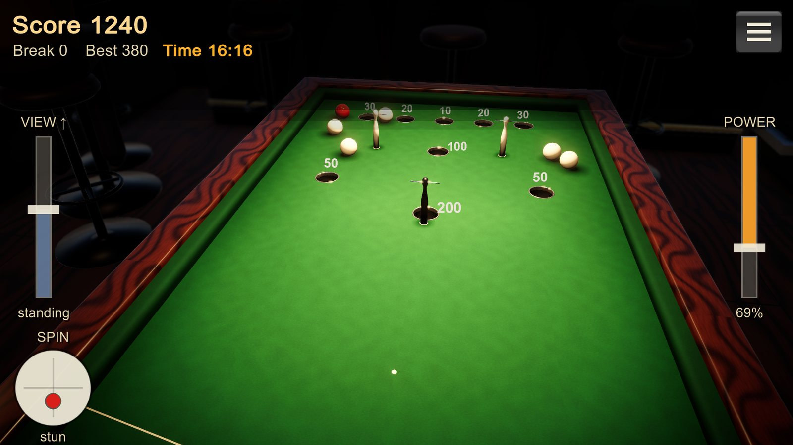

# How to play

## Controls

| To | Do this |
|---|---|
| **Aim** | Drag sideways anywhere on the table, or tap a ball to aim at it. Tap the middle of the ball for a full hit, or towards its edge for a thinner cut. |
| **Strike** | Pull down on the **POWER** bar on the right and let go. Slide back to the top to cancel. |
| **Change the view** | Drag the **VIEW** slider on the left up to stand over the table. Top view is in the menu. |
| **Place the ball** | When you play from the D, drag the cue ball to where you want it. |
| **Add spin** | Drag the red dot on the cue-ball picture to hit low (backspin), high (topspin) or to the side. |

?> New to the game? On first launch you're offered a short, hands-on tutorial ("Show me how to play"), or you can go straight in ("Just play"). You can start it again any time from **Help → Tutorial**.

## The table

  30201020305050100200

- **The holes:** 30, 20, 10, 20, 30 across the top, two 50s, the 100, and the 200 in the middle.
- **The balls:** seven white balls and one red. **The red scores double.**
- **The pegs:** a white peg either side of the 100, and the black peg in front of the 200.

## The rules in brief

- **Your break** carries on as long as every shot pots a ball. When a shot pots nothing, the break's points are added to your total.
- **You lose the break you're on** if:
  - the ball you strike misses every other ball;
  - a ball comes back over the baulk line or hits the D;
  - you knock down a white peg.
- **Knock down the black peg** and you lose your **whole score**.
- **Break position:** after potting both balls from the break position three times in a row, you must leave one up.

The rules are based on those of the English Bar Billiards Association.

## When the bar drops

When time is up, the bar drops. Balls you pot after that stay down, and you play on with the balls that are left.

**The last ball.** When only one ball is left, it's played from the middle of the D. The white pegs move into the 50 holes and the top holes are covered. The ball must come off a **side cushion** into the **100 or 200**.

- Playing alone, you can keep trying until it goes in, or end the game.
- With two players, you take turns at it.
- The black peg still costs your whole score.

You can also choose to end the game as soon as the bar drops (**Settings → Game**).
