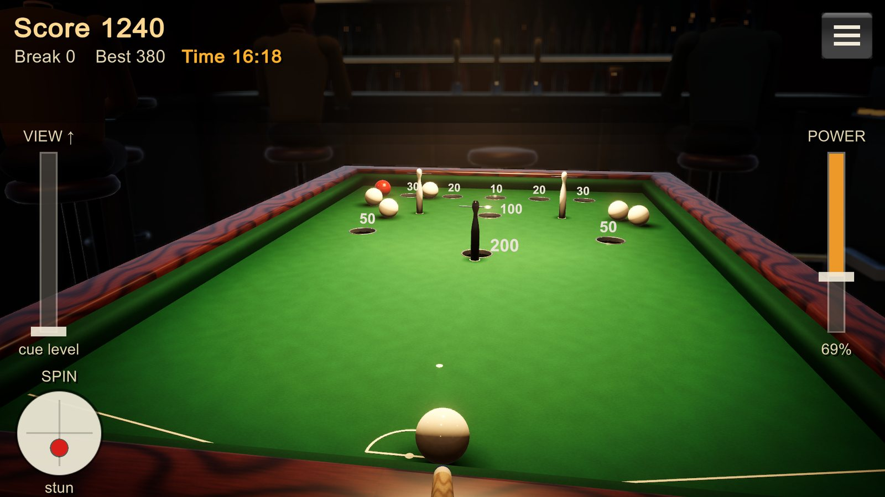
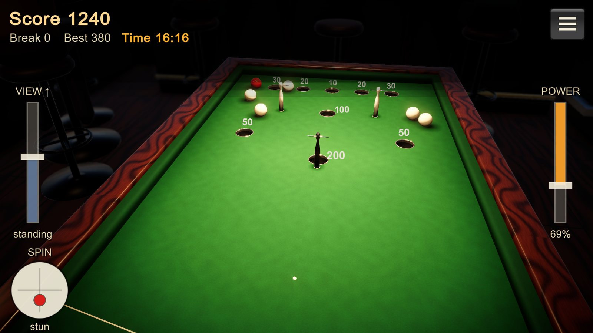
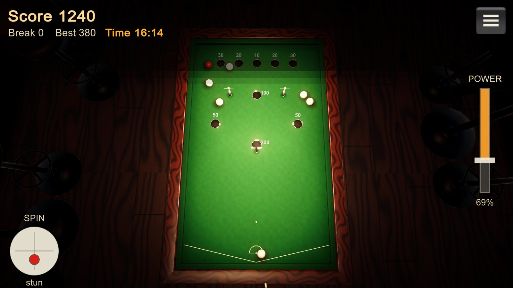
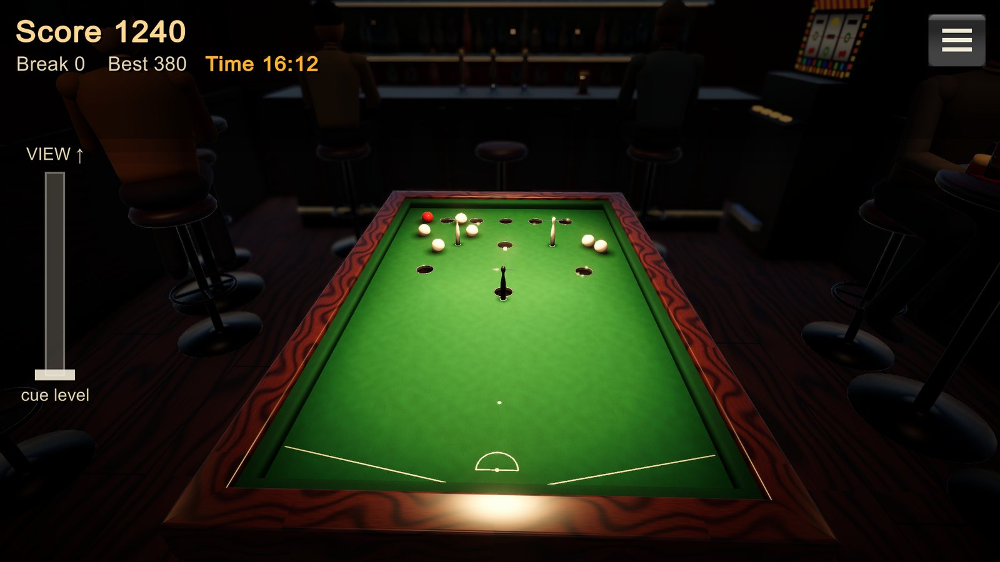
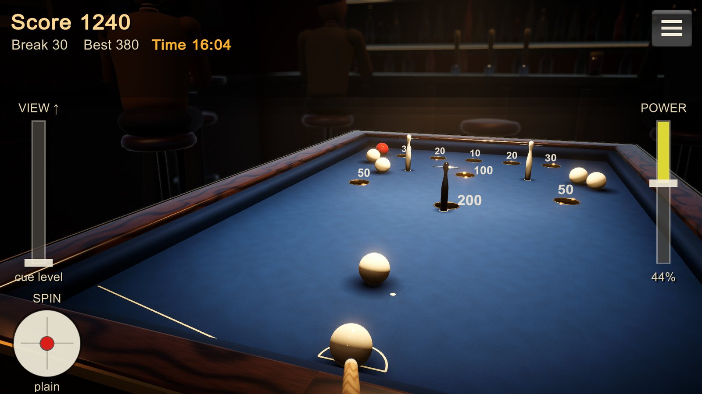
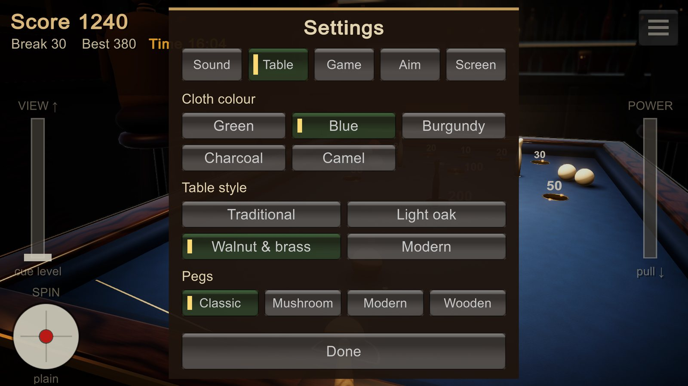
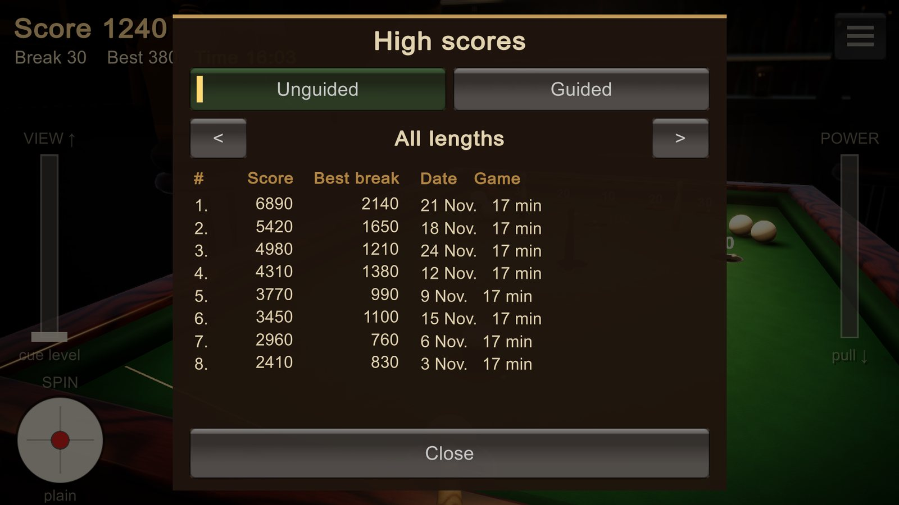
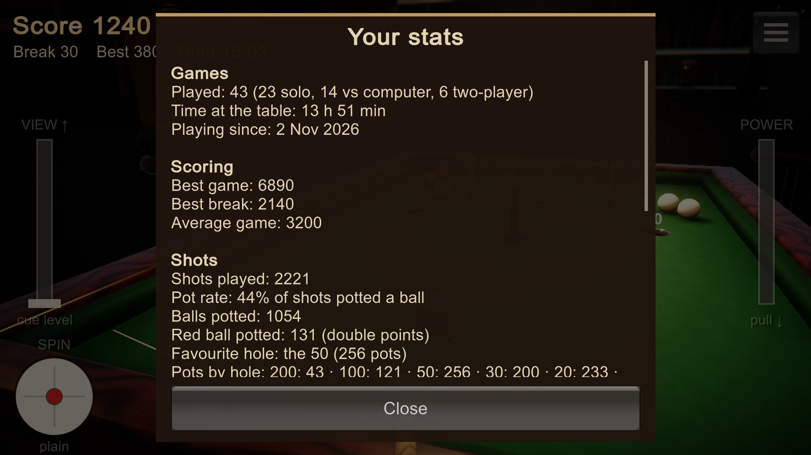

# Screenshots

## Gameplay video

  <iframe src="https://www.youtube-nocookie.com/embed/LUHeyVaug7s?rel=0" title="Bar Billiards gameplay" loading="lazy" allow="accelerometer; encrypted-media; gyroscope; picture-in-picture; fullscreen" allowfullscreen></iframe>

32 seconds of play with the Full aim guide on. <a href="https://www.youtube.com/watch?v=LUHeyVaug7s" target="_blank" rel="noopener">Watch on YouTube</a>

## Pictures

Click any picture to see it larger.

  <figure><figcaption><strong>The player's view.</strong> Cue drawn back, with the VIEW slider, POWER bar and spin control.</figcaption></figure>
  <figure><figcaption><strong>A higher view</strong>, using the VIEW slider to stand over the table.</figcaption></figure>
  <figure><figcaption><strong>Top view</strong>, from the menu.</figcaption></figure>
  <figure><figcaption><strong>Watching a shot run.</strong></figcaption></figure>
  <figure><figcaption><strong>A different table:</strong> Tournament blue cloth on walnut and brass.</figcaption></figure>
  <figure><figcaption><strong>Settings:</strong> choosing the table.</figcaption></figure>
  <figure><figcaption><strong>High scores</strong>, with a board for each game length.</figcaption></figure>
  <figure><figcaption><strong>Your stats</strong>: pot rate, favourite hole and more.</figcaption></figure>

The screenshots show the game with the aim guide switched off, so the table, the pub and the controls are what you see. The high scores and stats show sample numbers.
